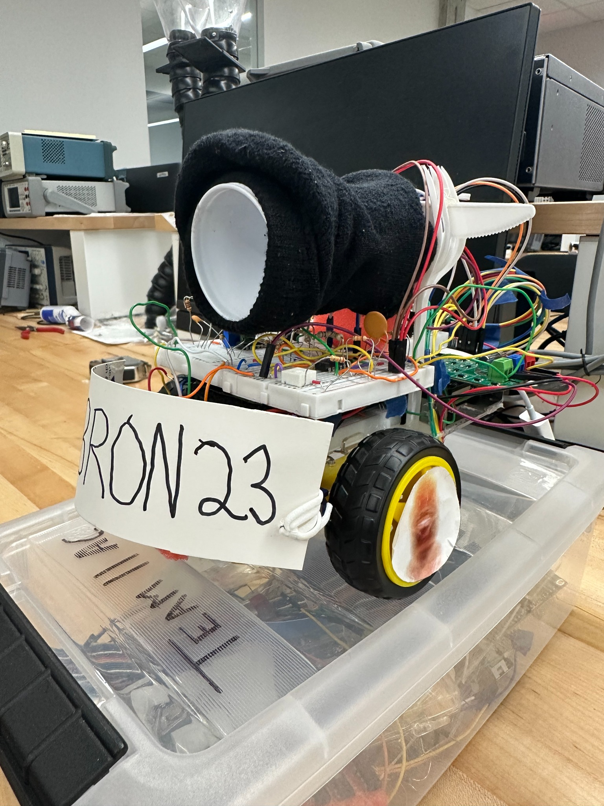
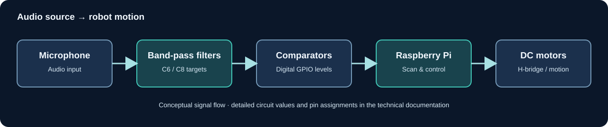
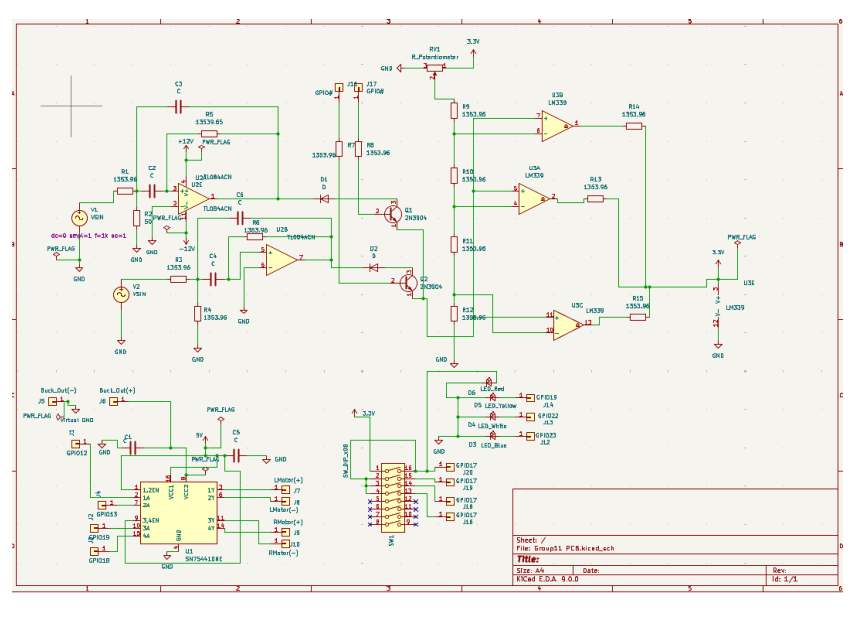
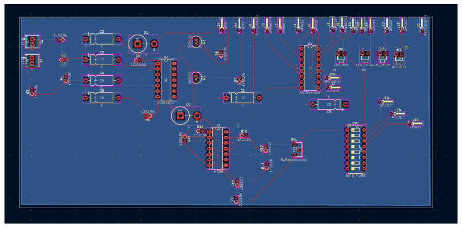
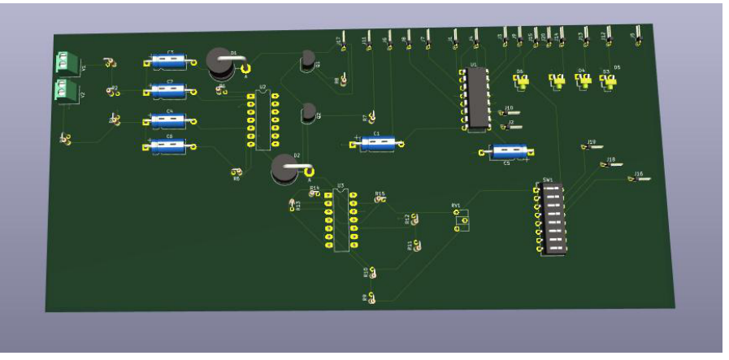

# Audio-Tracking Autonomous Car

**Raspberry Pi · Analog signal conditioning · Active filters · Comparator ADC · Motor control · PCB design**



*Original course prototype, including a breadboarded circuit and Raspberry Pi hardware.*



## Project overview

A spring 2025 UGA **ECSE 2920 Design Methodology** group project: develop a mobile robot that can detect selected sound frequencies, rotate to locate their source, and drive toward it. The system brings together a 24 V power architecture, microphone signal conditioning, active band-pass filters, comparator-based digitization, Raspberry Pi GPIO input, dual DC-motor control, and configurable autonomous modes.

The final code also executes predefined **straight, square and figure-eight** movement patterns. The system is documented primarily as an **engineering design and integration case study**; safe reproduction would require the complete original custom hardware.

[Full technical documentation](docs/Technical%20Documentation%20-%20Group%2011.pdf) · [User-manual demonstration](https://www.youtube.com/watch?v=HQ8RJdJg2CQ) · [Circuit/PCB design notes](docs/HARDWARE_AND_VALIDATION.md)

## Hardware and controls

| Subsystem | Design and integration |
|---|---|
| **Compute/control** | Raspberry Pi 4, Python, `gpiozero`, GPIO inputs/outputs and DIP-switch mode selection |
| **Audio front end** | Microphone, analog gain stage, op-amp active band-pass filters targeting **C6 and C8** |
| **Digitization** | Comparator-based level detection and GPIO interpretation; source code reads three digital signal pins |
| **Drive system** | Dual DC motors, motor-driver/H-bridge circuitry, experimental wheel timing calibration |
| **Power** | 24 V supply architecture with MOSFET-based buffered split rails for analog circuitry |
| **Electronics integration** | GPIO protection, breadboard prototype, multisubsystem schematic and a manufactured-board design exercise |

### Signal-to-motion path

```text
Sound source (C6 / C8)
        ↓
Microphone → Analog gain → Narrow band-pass filters
        ↓
Comparator thresholds / digital sensing
        ↓
Raspberry Pi GPIO → Signal-strength sampling
        ↓
Rotate and scan → estimate peak direction
        ↓
Motor driver → wheel motion → bump/contact response
```

See [the analog-filter and PCB design notes](docs/HARDWARE_AND_VALIDATION.md). The 73-page development log supplied for this portfolio review includes microphone-frequency characterization, circuit simulations, a narrow band-pass filter, transistor-based path selection for two frequencies, motor-drive calibration, and final KiCad/JLCPCB design work. Note that the existing GitHub technical-document PDF may be an earlier revision; an updated source copy is available for a later binary-document replacement.

## Autonomous operating modes

The [main mode-dispatch script](implementation/readAndRun.py) monitors a DIP switch and calls [motor control](implementation/driveControls.py) and [audio sampling](implementation/signalRead.py).

- **Straight / Square / Figure 8:** programmed maneuvers tested on the physical platform.
- **Single:** search for the C8 source using timed 360° sampling, reorient, then advance until the bump switch is triggered.
- **Multiple:** coordinate the C8 and C6 finding routines with additional navigation and return behavior.
- **Debug / manual tests:** calibrate sensor readings and inspect GPIO/motor subsystems.

The source implements a **7-second stable-mode confirmation** and a finite experiment window. Because the physical prototype used an experimental tether, fixed turning and stopping behavior is specific to the original test surface and vehicle.

## Hardware design gallery

The three figures below are cropped from the [Group 11 technical documentation](docs/Technical%20Documentation%20-%20Group%2011.pdf) and show the team's **design artifacts**, not proof that a fabricated PCB was installed on the pictured prototype.

| Circuit schematic | PCB routing and layout | PCB 3D design render |
|---|---|---|
|  |  |  |

## Demonstrations and artifacts

- [Original project user-manual video](https://www.youtube.com/watch?v=HQ8RJdJg2CQ)
- [DIP-switch and movement demonstration](https://drive.google.com/file/d/1XgXHwuuSpIESz2LLATXnXHudN5j106qy/view)
- [Figure-drawing demonstration](https://drive.google.com/file/d/1OlfSidla6XCciNYYy228Ne_JwDMFSPwQ/view)
- [Power-stage bench test](https://drive.google.com/file/d/1H0udTCTMY6EK56O3BoOKsdjk9Z2yBKzY/view)
- [Technical documentation](docs/Technical%20Documentation%20-%20Group%2011.pdf) and [original weekly deliverables](docs/course_deliverables/)

## Repository map

| Folder | Contents |
|---|---|
| [`implementation/`](implementation/) | Final Raspberry Pi mode dispatcher, motion primitives and ADC input logic |
| [`tests/`](tests/) | Independent GPIO, motor, switch and maneuver experiments |
| [`docs/`](docs/) | Technical documentation, design/validation summary, user manual link |
| [`docs/course_deliverables/`](docs/course_deliverables/) | Archived course checkpoint PDFs |
| [`hardware/datasheets/`](hardware/datasheets/) | Component references and GPIO pin allocation sheet |
| [`media/`](media/) | Editable system block diagram |

## Running the original code

With the specified GPIO/motor/sensor hardware wired and Raspberry Pi OS installed, from this project folder:

```bash
python3 implementation/readAndRun.py
```

Install project-specific Raspberry Pi GPIO dependencies as required. **Do not run this code connected to unverified motor power, rails, or GPIO wiring**; scripts drive outputs immediately. The repository preserves a course demonstration, not a hardware-agnostic reproducible robotics kit. The original system was tested physically, but no fresh hardware tests were performed during the portfolio cleanup.

## Team contributions and credits

**Group 11, Spring 2025:** Michael See (programming lead), Cade Toney and Fin Morton (hardware engineering), **Dawson Gulasa (technical documentation lead and cross-functional engineering support)**. All participated in design decisions, experiments, and integration. Dawson's original documented responsibility included weekly engineering deliverables, technical documentation, and the user manual; the project work and results belong to the team.

The [engineering design log](docs/Technical%20Documentation%20-%20Group%2011.pdf) preserves design alternatives and bench evidence rather than claiming the course project was an individually authored vehicle.
