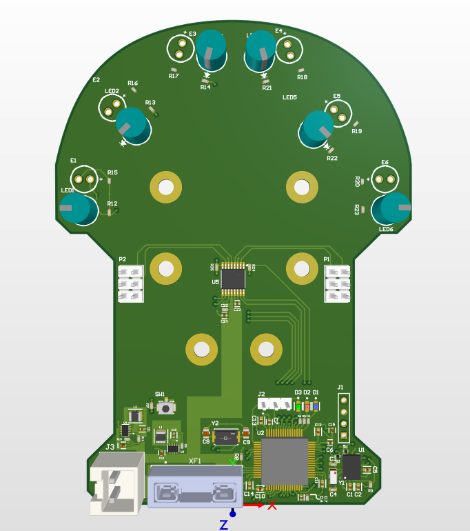
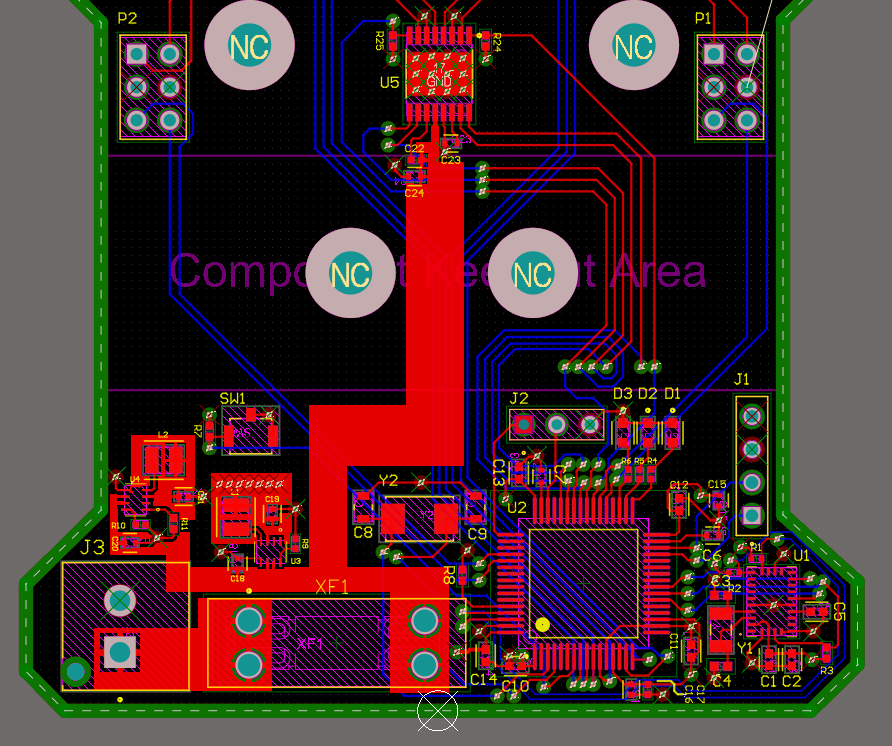

# Micromouse Autonomous Maze-Solving Robot

**IEEE Micromouse Competition Team · PCB & Electronics Lead · Fall 2025–present**

**Altium Designer · STM32F405 · BNO080 IMU · IR wall sensing · DRV8833 · DC/DC power · Embedded hardware**



## Project overview

The team's Micromouse platform is an autonomous, two-wheeled robot designed to navigate an **IEEE Micromouse 16 × 16 maze** using onboard sensing, motor control, and embedded navigation. My focus is leading the PCB and electronics effort, connecting sensor, motion, power, and microcontroller interfaces in a compact, layered circuit board.

**Status: in progress.** This repository documents the electronics design and its current design-stage artifacts. We will update verification and competition outcomes as they are established.

[PCB routing view](media/micromouse_pcb_layout.png) · [Full five-sheet electrical schematic](docs/Micromouse_Schematics.pdf) · [Architecture and interfaces](docs/ARCHITECTURE.md)

## Design highlights

| Subsystem | Engineering implementation |
|---|---|
| **MCU and debug** | STM32F405RGT6 with 3.3 V power/decoupling, clock source, reset and BOOT0; SWDIO/SWCLK debug header; UART TX/RX on a connector |
| **Motion sensing** | BNO080 inertial measurement unit with I²C host interface, interrupt, boot/reset and local clock circuitry |
| **Maze detection** | **Six TSAL6200 infrared emitters** and six receiver channels arranged around the board perimeter for wall sensing |
| **Motor control** | DRV8833 dual H-bridge driver, two PWM input pairs, separate motor connections, nSLEEP/nFAULT control and motor feedback lines |
| **Battery and rails** | Battery input with overcurrent protection provision; DC/DC **buck converters** produce 3.3 V and 5 V rails |
| **PCB layout** | Compact board outline, connector placement, routing/power copper and electronics integration in Altium |



## System architecture

```text
                 BNO080 IMU ───────┐
                                  │ I²C / INT
      Six IR wall sensors ────────┤
                                  ▼
                    STM32F405 microcontroller
                       │ PWM / control
                       ▼
              DRV8833 dual H-bridge
                       │
                 Two DC motors
                       │ feedback
                       └─────────────► STM32F405

       Battery → protection → 3.3 V / 5 V buck rails
                  SWD + UART / Bluetooth connections
```

See the [architecture notes](docs/ARCHITECTURE.md) for the individual nets, board-level interfaces and design considerations.

## Engineering contributions

- Led the hardware/PCB workstream for the IEEE Micromouse team and coordinated electronics requirements with embedded-system development.
- Developed the PCB schematic and layout integrating the STM32 microcontroller, IMU, six IR sensing positions, dual-motor driver, battery power and interface connectors.
- Planned routing, component placement, power distribution, firmware interfaces and programming/debug access in a compact mechanical footprint.
- Participated in circuit debug and bench bring-up to resolve hardware issues and advance the board design. This is **development-stage work**, not a claim of completed competition testing.

## Schematic walkthrough

The uploaded five-sheet schematic is dated **November 16, 2026**.

| Sheet | Source | What it documents |
|---|---|---|
| 1 | [IMU](docs/Micromouse_Schematics.pdf#page=1) | BNO080, I²C pull-ups, interrupt/reset, 32 kHz clock and decoupling |
| 2 | [MCU](docs/Micromouse_Schematics.pdf#page=2) | STM32F405 pin mapping, LEDs, oscillators, supply filtering, SWD, UART and BOOT0 |
| 3 | [Voltage regulators](docs/Micromouse_Schematics.pdf#page=3) | Battery connection, protection provision, 3.3 V and 5 V buck regulators |
| 4 | [IR sensors](docs/Micromouse_Schematics.pdf#page=4) | Six IR emitter and receiver positions |
| 5 | [Motor driver](docs/Micromouse_Schematics.pdf#page=5) | DRV8833 PWM inputs, motor connectors, fault and sleep interfaces |

The five sheets are included together as one PDF, not separate schematics. For specific net names and board-level design review considerations, see [SCHEMATIC_NOTES.md](docs/SCHEMATIC_NOTES.md).

## Media and project files

```text
Micromouse_Robot/
├── README.md
├── docs/
│   ├── ARCHITECTURE.md
│   ├── SCHEMATIC_NOTES.md
│   └── Micromouse_Schematics.pdf
└── media/
    ├── micromouse_pcb_3d.png
    └── micromouse_pcb_layout.png
```

The Altium-native design files and embedded firmware are not part of this source snapshot. Reproducing or manufacturing a board therefore requires a complete design review, final fabrication files, BOM and appropriate firmware. The materials here demonstrate board design and integration decisions rather than promising a build-ready hardware release.

## Design considerations and next steps

- Review driver **nSLEEP** startup behavior and defined MCU motor input states before enabling motor power.
- Verify battery and regulator selections, protection, layout and current/thermal performance against the final parts list.
- Confirm IR sensor geometry and response, BNO080 initialization, SWD/UART programming paths and motor control under test.
- Add measured bring-up data and updated PCB revisions as the development continues.

This is a collaborative IEEE team project. The PCB/electronics leadership described above is my contribution; autonomy algorithms, team testing and competition outcomes should be attributed to the broader team as appropriate.

[Back to engineering project portfolio](../README.md)
