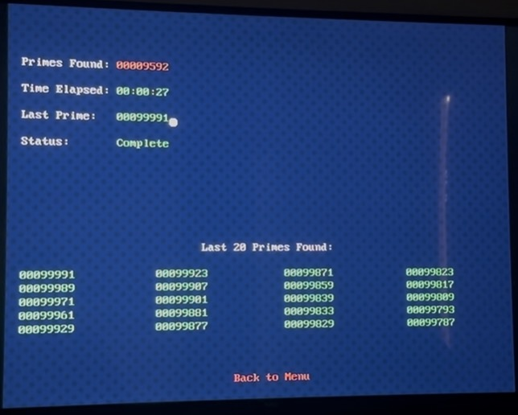
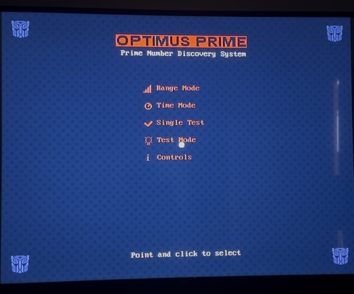
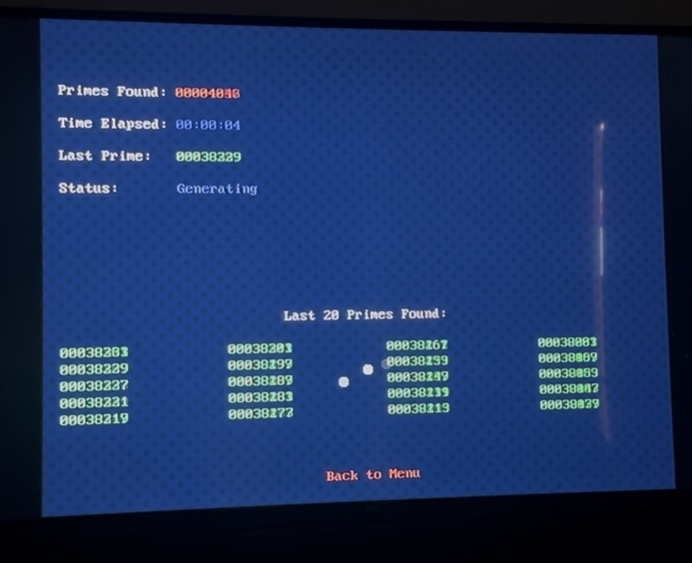
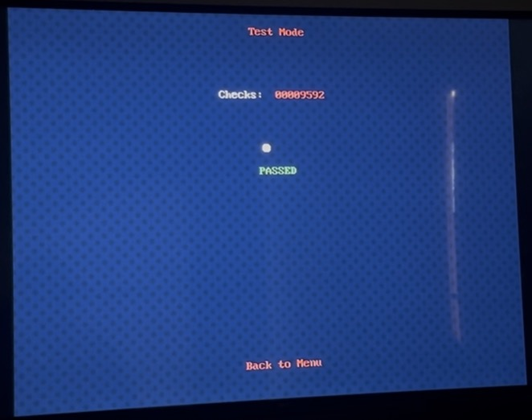

# Optimus Prime FPGA

**Interactive prime computation and SD-card verification on a Nexys A7-100T**

**Verilog · FPGA · DDR2/MIG · VGA · PS/2 · SPI/SD · Clock-domain crossing · RTL testbenches**



## At a glance

A hardware-accelerated interactive system for finding and verifying prime numbers. Developed in **Vivado 2024.2** for the Digilent **Nexys A7-100T**, the design combines a synthesizable prime engine, a four-screen-plus control flow VGA interface, mouse/keypad input, external DDR2 memory, and independent SD-card prime checking.

| Original hardware demonstration | Recorded result |
|---|---|
| 90-minute Time Mode run | **103,739 primes** found |
| 0–1,000,000 range | **48 min 40 s** |
| VGA output | **640 × 480 @ 60 Hz** |
| Reported FPGA utilization | ~**15% LUT**, ~**6% BRAM** |
| Timing closure | **Not met**; worst negative slack approximately **−4.9 ns** |

These figures are reported from the original project, not new measurements of this portfolio copy. The timing-closure limitation is an important engineering tradeoff—not hidden in this presentation.

[Full hardware demo](media/demo_video/README.md) · [Final report](docs/Optimus_Prime_Final_Report.pdf) · [Technical architecture](docs/ARCHITECTURE.md)

## System architecture

```text
Mouse / Keypad / Buttons
           │
     Input + UI FSM ─────────────────────┐
           │                            │
       Prime engine                VGA + sprites
           │                            │
       Prime storage           DDR2 framebuffer
           └────────────┬───────────────┘
                        │
                  MIG DDR2 memory

SD reader → hex parsing → test controller → PASS / FAIL on VGA
```

The system is a coordinated multi-clock-domain design, not a software program running on a processor. The top-level integration is [`rtl/top/top.v`](rtl/top/top.v), with separate Verilog modules for the prime engine, memory, UI, controls, mouse, and SD reader.

### Modes

| Mode | User action |
|---|---|
| **Range** | Search for primes between chosen limits |
| **Time** | Generate primes for a selected run time |
| **Single** | Check whether a selected number is prime |
| **Test** | Compare FPGA-generated primes against reference primes from an SD card |

### Prime arithmetic

[`prime_check_core.v`](rtl/prime_engine/prime_check_core.v) checks candidate divisors up to their square root. The modular controller and storage front end coordinate candidate generation, prime counts, display state, and DDR2 writes.

### Memory, display, and CDC

The DDR2 memory controller supports both the prime store and the double-buffered VGA framebuffer. The VGA path shows interactive controls, results, and Test Mode feedback. The source includes independent clock-domain synchronizers, event synchronizers, and asynchronous FIFOs to handle transfers between computation, SD, display, and MIG domains.

### Independent verification

The SD path streams ASCII-encoded reference data through byte synchronization, parsing, and a test controller. On-screen PASS/FAIL compares stored FPGA-generated primes with independent reference data rather than merely reusing the prime engine's own status.

## Visual walkthrough

| Main menu | Generating primes |
|---|---|
|  |  |
| **Results** | **Test Mode** |
|  |  |

## Source and verification map

| Folder | Contents |
|---|---|
| [`rtl/top/`](rtl/top/) | Integrated FPGA top module |
| [`rtl/prime_engine/`](rtl/prime_engine/) | Computation and storage/control logic |
| [`rtl/memory/`](rtl/memory/) | DDR2 controller, write logic, framebuffer/CDC |
| [`rtl/common/`](rtl/common/) | FIFOs, synchronization and VGA timing |
| [`rtl/input/`](rtl/input/) and [`rtl/mouse/`](rtl/mouse/) | Keypad, mouse, buttons and input debounce |
| [`rtl/ui/`](rtl/ui/) | VGA screen rendering and cursor overlays |
| [`rtl/sd_card/`](rtl/sd_card/) | SD reader, data parser, test controller |
| [`sim/`](sim/) | **11 self-checking Verilog testbenches** |
| [`ip/`](ip/) | MIG and PLL configuration/source IP |
| [`constraints/`](constraints/) | Nexys A7-100T pin constraints |
| [`mem/`](mem/) | Character, cursor, and font ROM initialization files |

## Reproduction notes

This is a **hardware-oriented design case study**. Rebuilding requires Vivado, the matching Nexys A7 board, generated Xilinx IP products, memory initialization files, and appropriate constraints. Testbenches are available for source inspection and simulation, but this portfolio branch does not include a one-command CI flow or a newly rerun synthesis report.

Read the [architecture notes](docs/ARCHITECTURE.md) for clock boundaries, FPGA integration, design limitations, and validation scope.

## Engineering contributions

The project involved end-to-end RTL integration across the prime engine, control UI, DDR2/memory, VGA, PS/2, and SD verification subsystems, plus CDC and simulation-based debugging. Collaborative coursework is described as a system-level team effort unless a specific module is individually attributed by the original final report.

**Technical report:** [Optimus Prime FPGA Final Report](docs/Optimus_Prime_Final_Report.pdf). **Demo:** [hardware walkthrough](media/demo_video/README.md).
