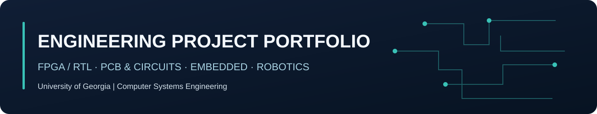

# Engineering Project Portfolio

**Digital hardware · FPGA/RTL · Embedded systems · Circuit design · Robotics**

A curated collection of engineering, academic, and research projects from the University of Georgia. Projects are presented as technical case studies: **the engineering problem, architecture, implementation, verification, and artifacts**. Many were collaborative course or lab projects; team ownership and limitations are described in each project.



## Featured digital hardware

| Project | Engineering focus | Explore |
|---|---|---|
| **32-bit Single-Cycle Computer (SCC)** | Verilog processor, ISA, microcoded signed MUL/DIV, stack, automated RTL verification | [Processor, source & report](SCC_32bit_Processor/) |
| **Optimus Prime FPGA** | Nexys A7-100T, multi-clock-domain RTL, DDR2, VGA, SD-card verification, CDC | [FPGA system & demonstrations](Optimus_Prime_FPGA/) |

## Embedded systems & circuit engineering

| Project | Engineering focus | Explore |
|---|---|---|
| **Micromouse Autonomous Maze Robot** | STM32F405 PCB, six IR sensor positions, BNO080 IMU, DRV8833 motor control and power design (in progress) | [PCB design & schematic](Micromouse_Robot/) |
| **Audio-Tracking Autonomous Car** | Raspberry Pi, analog filters, comparators/ADC, motor control, PCB and autonomous motion | [Hardware & controls](Audio_Tracking_Autonomous_Car/) |
| **Reaction-Time Training Button** | MicroPython, sensors and calibration, PCB/enclosure design, OLED, Wi-Fi telemetry | [Circuit, firmware & media](reaction_time_training_button/) |
| **Seven-Segment Clock & Timer** | Raspberry Pi GPIO, DFF-latched displays, keypad FSM, timing characterization | [Hardware & timing results](SSD_Clock_Timer/) |
| **Robotic Inspection Research** | Depth/vision-based localization, robot interfaces, scanning, data processing | [Research documentation](Research_Documentation/) |

## Supporting software projects

| Project | Skills | Explore |
|---|---|---|
| **Parallel Diagonal Sum Analyzer** | C, POSIX threads, memory management, sliding-window diagonals | [Source & examples](diagonal_sum_analyzer/) |
| **Geography Game Show Quiz** | JavaFX, Maven, OOP, CSV resources, persisted quiz results | [Java application](game_show_quiz/) |
| **Snake Game** | C, console I/O, game loops, input/state logic | [Source & build guide](snake_game/) |

## How the repository is organized

Each project is **self-contained** and links to the relevant source, technical report, demonstrations, and engineering decisions. Where possible, hardware projects include photographs, circuit schematics, or measured results. Code-heavy projects include tested or documented build/run instructions.

```text
.Projects/
├── SCC_32bit_Processor/             # RTL processor + verification + final report
├── Optimus_Prime_FPGA/              # FPGA RTL, constraints, simulation and media
├── Micromouse_Robot/                # Competition PCB, IR/IMU/motors, schematics
├── Audio_Tracking_Autonomous_Car/   # Analog front-end, Pi controls and documentation
├── reaction_time_training_button/   # MicroPython, PCB/enclosure and hardware media
├── SSD_Clock_Timer/                 # GPIO clock, experiments and supporting report
├── Research_Documentation/          # Robotics research memo and demonstrations
├── diagonal_sum_analyzer/           # Parallel C algorithm and sample cases
├── game_show_quiz/                  # JavaFX/Maven application
├── snake_game/                      # Console game in C
└── media/                           # Portfolio banner
```

### Clone and explore

```bash
git clone https://github.com/Dawson-Gulasa/.Projects.git
cd .Projects
```

Open any project folder and follow its README. FPGA/PCB and Raspberry Pi projects may require specific hardware, IP, operating systems, or instrumentation; they are shared to **demonstrate design and engineering methodology**, not as guaranteed plug-and-play products. Reported results were recorded during the original projects unless otherwise stated.

---

**About this collection:** Focused on **digital hardware, PCB/circuit design, embedded systems, and hardware-software integration**. The [professional website](https://dawson-gulasa.github.io/) provides case-study pages and will continue to evolve as projects advance.

For team-authored coursework, course-provided assets, and research contributions, refer to each project's documentation. Do not redistribute third-party reference material under an assumed blanket license.
