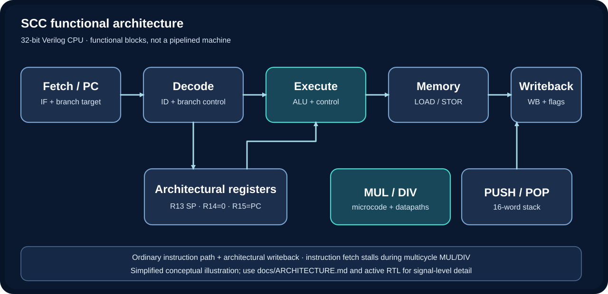
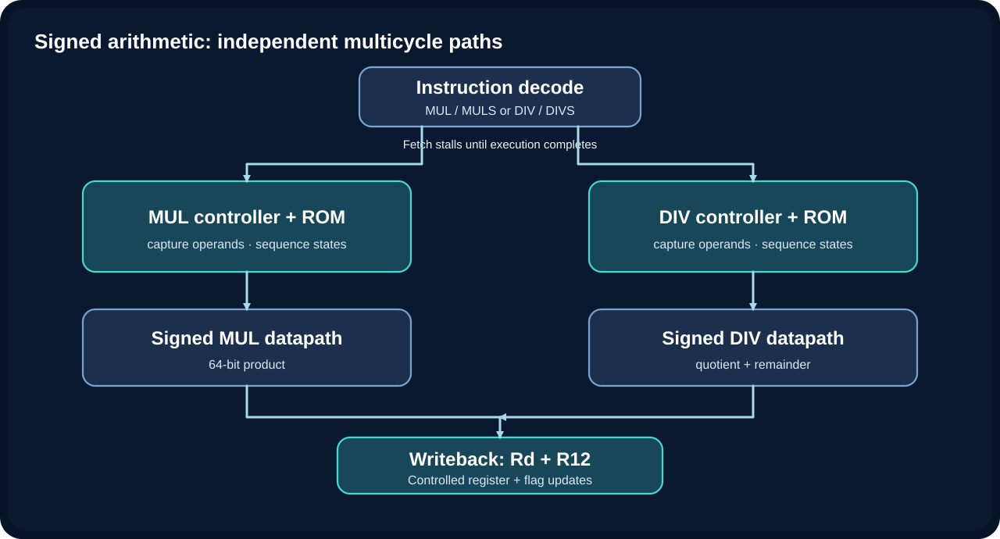

# 32-bit Single-Cycle Computer (SCC)

**Custom Verilog CPU · 32-bit class ISA · Microcoded MUL/DIV · RTL verification**

**University of Georgia — CSEE 4290 Computer Architecture (Fall 2026)**  
**Group 4:** Dawson Gulasa · Joshua Oh · Sam Baker  
**Tools:** Verilog, Icarus Verilog, Python 3, PowerShell, GTKWave, Git



## Overview

Designed and integrated a modular **32-bit processor implementing the course-defined instruction set architecture (ISA)**. The processor supports arithmetic and logic, load/store operations, conditional and unconditional branching, architectural flags, and a 16-word PUSH/POP stack. Signed multiplication and division use dedicated microcode controllers and arithmetic datapaths to execute over multiple clock cycles.

The fetch, decode, execute, memory, and writeback *modules* are functional partitions, **not a pipelined design**. Ordinary instructions execute in a single-cycle-style processor; microcoded arithmetic intentionally stalls instruction fetch.

### Final CP6 verification evidence

| Suite | Results recorded in the final team report |
|---|---|
| Internal directed/unit/application regression | **20 of 20 PASS**, zero reported failures |
| Fall 2026 classwide deliberate fault injection | **9 of 9 injected faults detected** |

These are documented results of the original final submission; **the curated GitHub copy has not yet been independently rerun**. Fault detection is a negative test, not nine additional clean passes. See [verification details](docs/VERIFICATION.md).

## Key engineering features

- **Modular datapath and control:** fetch/PC selection, instruction decode, branch evaluation, ALU execution, memory access, architectural writeback, and SNZCV flags.
- **Register architecture:** R13 stack pointer (reset `0x0000FFC0`), R14 hardwired zero, and R15 PC readback.
- **Signed arithmetic:** MUL/MULS produces a 64-bit signed product (lower word to `Rd`, upper word to `R12`); DIV/DIVS writes quotient to `Rd` and remainder to `R12`.
- **ROM-sequenced multicycle operations:** independent controllers, arithmetic datapaths, operand capture, fetch stalls, and architectural result writeback; divide-by-zero and signed-overflow behavior handled.
- **Stack:** a 16-word PUSH/POP stack, occupancy tracking, full/empty behavior, S flag, and stack/ordinary memory arbitration.
- **Verification:** self-checking Verilog testbenches, automated regression/fault injection, class assembler, and reference memory comparisons.



[Architecture deep dive](docs/ARCHITECTURE.md) · [Verification methodology](docs/VERIFICATION.md) · [Team contributions and credits](docs/CONTRIBUTIONS.md)

## My contributions

My primary work included developing and integrating architectural register storage, branch/ALU and processor execution paths, signed division and stack functionality, and architectural writeback. I coordinated final processor RTL corrections and separated signed multiplication arithmetic into `mul_datapath.v` so arithmetic calculation and microcode sequencing have distinct responsibilities. I also organized the final code package and reviewed the full regression results. This was a **three-person project**; teammates and course-provided resources are credited in [CONTRIBUTIONS.md](docs/CONTRIBUTIONS.md).

## Build and simulate

**Prerequisites:** Windows PowerShell, Python 3 available as `python`, and Icarus Verilog available as `iverilog` and `vvp`. Keep the sibling `Assembler/`, `SelfChecker/`, `F26_Testcases/`, and `processor/` directories together.

From `SCC_32bit_Processor/processor/`:

```powershell
# 20-case internal regression
.\verification\run_cp5_regression.ps1

# Nine normal Fall 2026 cross-group programs
.\verification\run_f26_demo.ps1

# Nine deliberate fault-injection checks
.\verification\run_f26_demo.ps1 -Force
```

Or from the project root:

```powershell
.\RUN_ALL_TESTS.ps1
.\RUN_ALL_TESTS.ps1 -RegressionOnly
.\RUN_ALL_TESTS.ps1 -ForceOnly
```

The assembler creates `processor/output.mem` per application. Both `processor/ucode.mem` and `processor/div_ucode.mem` are **required runtime inputs**. Simulation outputs and generated assembly artifacts are excluded via `.gitignore`.

Optional GNU Make example, run inside `processor/`:

```sh
make PROGRAM=bubble_sort TB=tb_cp5_bubble_sort_portable run
```

The portfolio Makefile includes all 24 active RTL modules, including `mul_datapath.v`; the PowerShell script is the authoritative complete regression.

## Source layout

```text
SCC_32bit_Processor/
├── README.md
├── START_HERE.md
├── RUN_ALL_TESTS.ps1
├── Assembler/                 # Python class assembler + ISA definition
├── SelfChecker/               # Reference memory comparison utility
├── F26_Testcases/             # Nine Fall 2026 programs and self-checking benches
├── processor/
│   ├── rtl/                   # 24 active Verilog modules
│   ├── assembly/              # 13 directed programs + MUL/DIV microcode sources
│   ├── verification/          # 20 regression benches, fault injection, golden CSVs
│   ├── ucode.mem
│   ├── div_ucode.mem
│   └── Makefile
├── docs/                      # Architecture, verification, credits
└── media/                     # Processor + microcode diagrams
```

## Full report and provenance

Read the [complete 121-page Group 4 CP6 final technical report](docs/Final_SCC_Report.pdf), included in this public portfolio repository. The original [Group 4 final CP6 source directory](https://github.com/Herring-UGACSEE-4290-F26/Group-Burger/tree/main/SCC/CP6-SCC_Complete) remains the authoritative class submission; access to that original repository may require permission.

This portfolio project is a curated source distribution based on the [final Group 4 CP6 directory](https://github.com/Herring-UGACSEE-4290-F26/Group-Burger/tree/main/SCC/CP6-SCC_Complete). It retains the files referenced by the final internal and Fall 2026 test launchers while excluding historical snapshots and earlier-year external suites. Publication is with permission and attribution; no unrestricted project-wide license is asserted.
