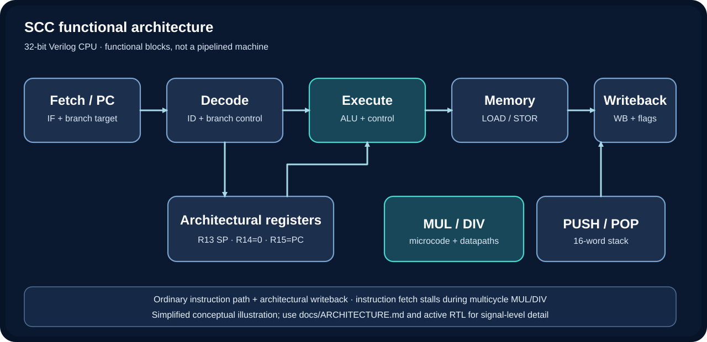
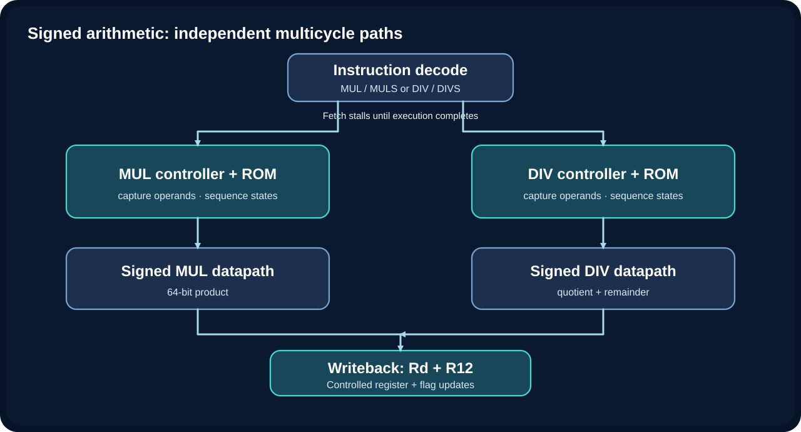

# SCC processor architecture

**Source of truth:** final CP6 Verilog files in `../processor/rtl/` and the Group 4 final checkpoint report, especially Sections 5–9. The IF, ID, EXE, memory, and WB divisions are **functional modules, not pipeline stages**.

## Functional block map

| Function | RTL files | Responsibility |
|---|---|---|
| Processor + memory | `scc_f26_top.v`, `scc.v`, `Instruction_and_data.v` | Class-defined interface and integrated instruction/data memory |
| Instruction fetch | `if_stage.v` | PC storage, increment, branch redirection, stall control |
| Decode and branch | `id_control_stage.v`, `id_stage.v`, `branch_control.v`, `error_status.v` | Instruction classification, immediates, condition tests, error status |
| Ordinary execution | `exe_cluster_stage.v`, `exe_stage.v`, `alu.v` | ALU operations, address calculations, arithmetic/stack requests |
| Register storage | `regs.v` | Operand reads, architectural registers, R13 stack pointer, protected R14/R15 |
| Writeback and flags | `wb_cluster_stage.v`, `flags.v`, `mul_integration.v` | Select register updates and maintain architectural SNZCV |
| Memory arbitration | `stack_memory_bus.v` | Ordinary LOAD/STOR versus stack transactions |
| Multiplication | `ucode_controller.v`, `ucode_rom.v`, `mul_datapath.v` | ROM-controlled MUL/MULS sequencing and signed 64-bit product |
| Division | `div_controller.v`, `div_ucode_rom.v`, `div_datapath.v` | ROM-controlled DIV/DIVS, signed quotient/remainder, errors |
| Stack | `stack_controller.v`, `stack_datapath.v` | 16-word PUSH/POP stack, address/pointer update, occupancy |

## Ordinary instruction operation

1. Fetch selects the PC, with branch redirection or an arithmetic stall where appropriate.
2. Decode classifies the 32-bit instruction and selects operands/immediates.
3. The register file returns operands; EXE performs the selected ordinary ALU/memory/branch operation or starts a microcoded arithmetic sequence.
4. The memory interface arbitrates ordinary and stack requests; writeback selects data and architectural register destinations.
5. Flags and PC updates are coordinated with the processor's enabled clocking.

These are not a five-stage pipelined retirement sequence.

## Registers and flags

- **R13:** stack pointer, reset `0x0000FFC0`; 16 words occupy addresses `0xFFC0` through `0xFFFF`.
- **R14:** hardwired zero; **R15:** program-counter readback, protected from ordinary writes.
- **SNZCV:** stack-full, negative, zero, carry/no-borrow, overflow conditions. Stack status S is distinct from arithmetic NZCV.

## Multicycle signed MUL/DIV

Both units capture their operands and destination register, stall fetch while active, sequence dedicated arithmetic and controlled architectural writeback.

| Instruction | `Rd` | `R12` |
|---|---|---|
| MUL/MULS | Low 32 bits of signed 64-bit product | Upper 32 bits |
| DIV/DIVS | Signed quotient | Signed remainder |

The multiplication controller and arithmetic datapath were separated in CP6 to make the sequential control and combinational arithmetic distinct. Division handles divide-by-zero and signed-overflow cases. Register writeback selection avoids unrelated state changes during multicycle execution.

## Stack and branching

The stack controller tracks 16-word occupancy; stack datapath supplies stack addresses, memory data, and R13 updates. The shared memory interface arbitrates stack and ordinary memory operations. Branches select their target/condition in the control path without speculative prediction.

For exact behaviors, see active RTL and the final report, especially Sections 7–9. See [verification](VERIFICATION.md), [contributions](CONTRIBUTIONS.md), and [project home](../README.md).
