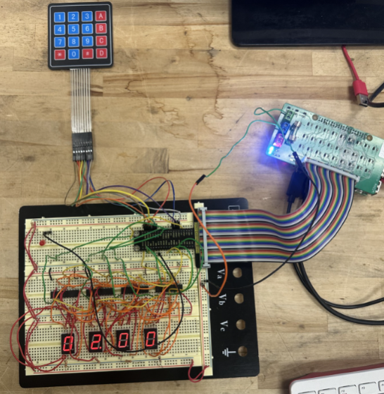
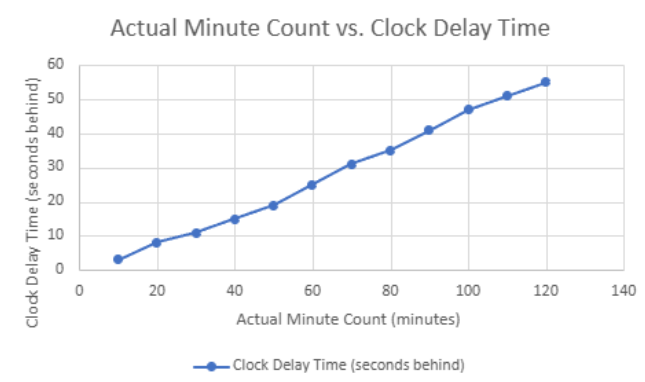

# Seven-Segment Display Clock & Timer

**Raspberry Pi · DFF-latched LED displays · 4×4 keypad · real-time FSM · timing experiments**



## Overview

Built a four-digit digital clock and timer with a Raspberry Pi 4, **CD74HCT574 D-type latches** driving seven-segment displays, a matrix keypad, and a GPIO-based state machine. In addition to the working hardware, the project compared two software timing approaches over two-hour runs, exposing scheduling and calibration errors in a general-purpose operating system.

[Demo videos](media/demo_video/README.md) · [Full report](docs/Group7_SSD_Clock_Timer_Report.pdf) · [Final application](src/final/full_clock_module.py)

## Engineering highlights

- **GPIO/digital interfacing:** Shared segment bus with a separate latch clock for each of four display digits; keypad scanning and debouncing; on/off toggle and error LED.
- **Finite state machine:** IDLE (00:00), AUTO (reads the Pi system clock), and MANUAL (user-entered clock with internal time accumulation).
- **Nonblocking manual timing:** Calibrated busy-loop iteration counting, split into chunks to keep keypad responses available during time advancement.
- **Physical measurements:** Benchmarked manual iteration timing against a `time.sleep(1)` approach for **two hours**, using recorded elapsed-time error.

## Original timing results

| Timing method | Drift over 2 hours | Error |
|---|---:|---:|
| Calibrated manual busy-loop | **55 s** | **0.764%** |
| `time.sleep(1)` comparison | **295 s** | **4.097%** |

The measured 55-second drift was approximately **5.36× smaller** than the comparison method's 295-second drift. These results are **specific to the original implementation, load, and hardware**, not universal evidence that busy loops outperform system clocks. The manually calibrated counter still drifted and is not a substitute for a hardware real-time clock.



### Evidence and demonstrations

| Hardware and measurements | Links |
|---|---|
| Assembled display and controls | [Hardware photo](media/screenshots/hardware_setup.png) |
| Manual 2-hour result | [Measured result](media/screenshots/manual_2hr_test_result.png) · [Drift graph](media/screenshots/manual_timing_drift_graph.png) |
| `time.sleep()` 2-hour result | [Measured result](media/screenshots/sleep_2hr_test_result.png) · [Drift graph](media/screenshots/sleep_timing_drift_graph.png) |
| Timelapse videos | [Two demonstrations](media/demo_video/README.md) |
| Design detail | [Full technical report](docs/Group7_SSD_Clock_Timer_Report.pdf) |

## Operation

- Press **A** for AUTO, **B** for manual time entry.
- In MANUAL, the active digit blinks while editing and the system increments time after confirmation.
- Press **#** to toggle the display; three successive **B** presses within the configured interval reset to IDLE.
- Invalid entries trigger the error/status LED.

## Repository layout

```text
SSD_Clock_Timer/
├── src/final/full_clock_module.py     # Integrated operating program
├── src/development/                 # Historical subsystem experiments
├── media/screenshots/               # Hardware images and timing graphs
├── media/demo_video/                # Original timelapse links
├── docs/Group7_SSD_Clock_Timer_Report.pdf
└── README.md
```

## Running on hardware

1. Wire the Raspberry Pi, latches, 4×4 keypad, four seven-segment displays and LED as described in the report.
2. Install Raspberry Pi OS with Python and `RPi.GPIO` support.
3. From the project folder, execute `python3 src/final/full_clock_module.py` **on the correctly wired Pi**.

`src/development/` retains experiments as development history; the **final application** is `src/final/full_clock_module.py`. The GPIO configuration is board-specific. This portfolio update did not rerun the hardware or timing experiment. Check the [report](docs/Group7_SSD_Clock_Timer_Report.pdf) before modifying the wiring.

## Team / skills

University of Georgia team course project. Highlights include sequential digital interfacing, GPIO control, embedded Python, finite-state design, debouncing, hardware debugging, and experimental measurement. The team-owned results and design are not presented as solely authored by one contributor.
