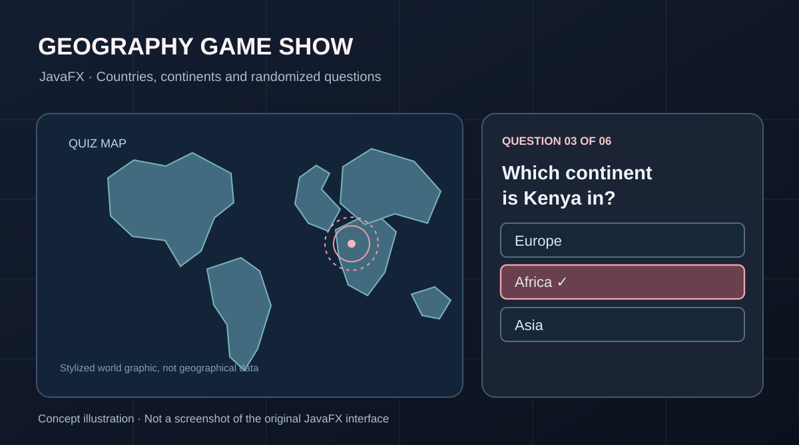

# Geography Game Show Quiz (JavaFX)

**Java · JavaFX · Maven · Object-oriented design · CSV resources · Local persistence**

## Overview

A desktop geography quiz implemented with JavaFX. Each round selects **six unique countries**, asks users to identify their continents, displays immediate feedback, and records score history between sessions. Country/continent mappings are shipped as a CSV resource inside the project; questions and score management use separate Java model classes.



*Concept visualization of the quiz flow. The actual interface is implemented in JavaFX.*

## What it demonstrates

- JavaFX desktop windows, radio-button selection, event callbacks, and timed feedback transitions.
- Object-oriented modeling across `Country`, `CountryCollection`, `Question`, `Quiz`, `QuizScore`, and `QuizResult`.
- Data-driven questions loaded from [`country_continent.csv`](src/main/resources/country_continent.csv).
- Persistence using Java object serialization to **`quiz_results.dat`** in the application's working directory.
- Maven-based dependency setup and a self-contained Java resource path instead of the original developer-specific absolute path.

## Build and run

Install **JDK 17** and **Maven**. JavaFX desktop execution also requires a graphical environment; it is not a browser or command-line application.

```bash
cd game_show_quiz
mvn compile
mvn javafx:run
```

The [Maven POM](pom.xml) includes JavaFX controls, Apache Commons CSV, and the JavaFX Maven plugin.

A console smoke entry point under `src/test/java/` exercises the CSV-backed country model, but this is not a conventional automated JUnit suite. **Fresh GUI functionality has not been verified in the portfolio edit environment.**

## Project layout

```text
game_show_quiz/
├── pom.xml
├── src/main/java/edu/uga/cs1302/quiz/  # GUI + domain/data classes
├── src/main/resources/                 # Portable CSV quiz dataset
├── src/test/java/                      # Console test entry point
└── README.md
```

### User flow

```text
Menu → Six randomized geography questions → Correct/incorrect feedback
                                   ↓
                            Score + date recorded
                                   ↓
                     View previous local attempts
```

**Known limitations:** Scores are stored in a local Java serialization file, not a network account/database. JavaFX's runtime availability and native libraries depend on the operating system and JDK. Data and the implementation are shared as a course software example.

## Files to inspect

[JavaFX entry point](src/main/java/edu/uga/cs1302/quiz/GeographyQuiz.java) · [Country model/CSV reader](src/main/java/edu/uga/cs1302/quiz/CountryCollection.java) · [Quiz engine](src/main/java/edu/uga/cs1302/quiz/Quiz.java) · [Resources](src/main/resources/country_continent.csv)
