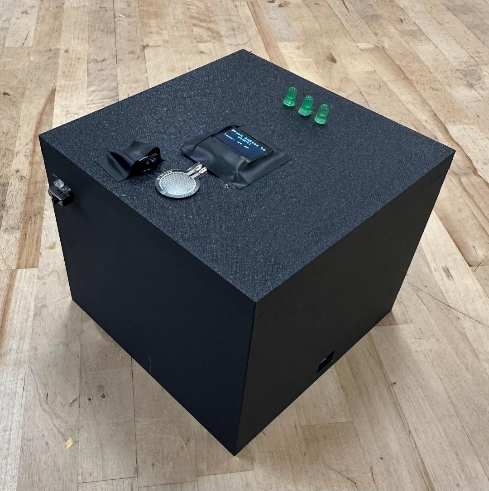
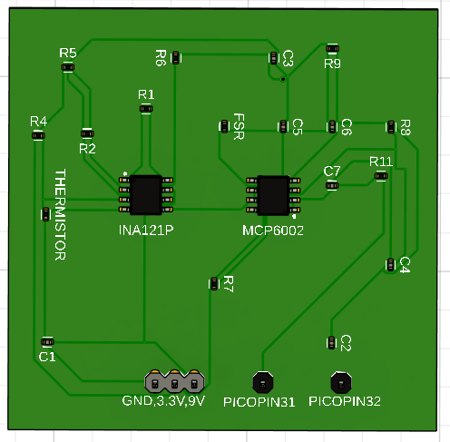

# Reaction-Time Training Button

**MicroPython · Raspberry Pi Pico/Pico W · PCB and enclosure design · FSR/IR sensors · OLED · IoT**



## Overview

A standalone hardware reaction-time trainer combining a **force-sensitive resistor (FSR)**, infrared presence input, thermistor measurement, LED visual cue, 128×64 OLED interface, and optional ThingSpeak reaction-time leaderboard. The prototype integrates a purpose-designed PCB, documented wiring, and a 3D-printed enclosure.

[Device demonstration](https://drive.google.com/file/d/13KiLQajpabt88BUegUfWbOQVhlgvolvL/view) · [Final report](docs/Sensors_Project_Report.pdf) · [Schematic](hardware/wiring/Circuit_Schematic.pdf)

## Engineering highlights

| Subsystem | Implementation |
|---|---|
| **Sensors** | FSR force conversion from characterized voltage table; IR detection; thermistor temperature conversion and smoothing |
| **Embedded control** | MicroPython finite-state machine, hardware sensor acquisition, randomized start delays, false-start handling |
| **User interface** | SSD1306 I²C OLED and LED cue; reaction time and peak force display |
| **Safety and feedback** | Temperature threshold and visible error state; anti-cheat hold behavior |
| **Communications** | Wi-Fi and ThingSpeak upload/query helper for recent results |
| **Hardware integration** | PCB layout, wiring schematic, BOM, enclosure CAD, 3D renderings and assembled photos |

## Hardware gallery

| Assembled product | Circuit and PCB |
|---|---|
|  |  |
|  |  |

Explore [component reference datasheets](hardware/datasheets/), [PCB routing](hardware/pcb/3D_Renderings/Routing.png), [enclosure CAD](hardware/enclosure/CAD/), [full BOM](bom/Project_BOM.xlsx), and [wiring diagram](hardware/wiring/Circuit_Schematic.pdf).

## Embedded state machine

```text
WAIT_ARM → WAIT_RELEASE → PRIMED
                         │
                     random delay
                         │
               LED_ON / response timer
                         │
           FSR + IR timestamps + peak force
                         │
                 OLED result display
                         │
              Wi-Fi / ThingSpeak update
                         │
                     WAIT_ARM
```

The code includes an **ANTICHEAT** branch for premature presses and a **temperature ERROR** state. Firmware is in [`firmware/src/main.py`](firmware/src/main.py); OLED driver code is in [`firmware/lib/`](firmware/lib/).

## Repository layout

```text
reaction_time_training_button/
├── firmware/src/             # MicroPython app and network helpers
├── firmware/lib/             # SSD1306 driver
├── firmware/config/          # Credential template, never actual credentials
├── hardware/datasheets/      # Manufacturer component reference PDFs
├── hardware/pcb/             # CAD design and board imagery
├── hardware/enclosure/       # 3D-printable CAD and renderings
├── hardware/wiring/          # Electrical schematic
├── media/photos/             # Prototype photos
├── bom/                      # Parts list
├── docs/                     # Course specification and final report
└── README.md
```

## Firmware setup (hardware required)

Use MicroPython on a **Wi-Fi-capable Pico board** if deploying the current `main.py` unchanged. The application **imports Wi-Fi and credential modules at startup** even when telemetry is disabled, so it currently requires `secrets.py` on the device. The repository includes **only a template**.

1. Install MicroPython and select the device in Thonny or `mpremote`.
2. Copy [`firmware/config/secrets_template.py`](firmware/config/secrets_template.py) to an **untracked** `firmware/config/secrets.py`; fill in Wi-Fi and ThingSpeak credentials for your private device.
3. Copy `main.py`, `wifi_connect.py`, `thingspeak_post.py`, and `secrets.py` to the Pico root. Copy `ssd1306.py` under `/lib/`. The main script imports all four names.
4. Power the correctly wired hardware and reset the board.

Using `mpremote` from this project folder, for example:

```bash
mpremote connect auto fs mkdir :/lib
mpremote connect auto fs cp firmware/lib/ssd1306.py :/lib/ssd1306.py
mpremote connect auto fs cp firmware/src/main.py :/main.py
mpremote connect auto fs cp firmware/src/wifi_connect.py :/wifi_connect.py
mpremote connect auto fs cp firmware/src/thingspeak_post.py :/thingspeak_post.py
mpremote connect auto fs cp firmware/config/secrets.py :/secrets.py
mpremote connect auto reset
```

**Security:** `secrets.py` is excluded by project `.gitignore`; the example file is intentionally non-secret. Avoid committing API keys or passwords in screenshots, source, or Git history. Telemetry uses legacy HTTP in this course prototype, so do not use production credentials.

## Limitations / verification

The repository contains the original firmware, PCB/physical artifacts, reports, and recorded demonstration. This cleanup fixes an uninitialized LED output and credential-ignore configuration, but **does not claim a fresh Pico execution or electrical validation**. Firmware and wiring must be checked on the original device.

This was collaborative course work; board, firmware, and system-level functionality are presented as a team project. See the [technical report](docs/Sensors_Project_Report.pdf) for source results and circuit details.
