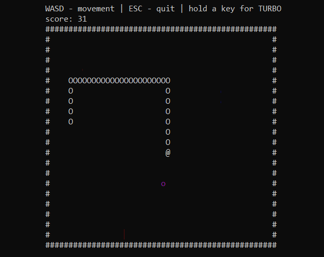

# Snake Game in C

**C · Windows console · Real-time keyboard input · Game-loop programming**



*Console gameplay image supplied for the portfolio. The published source uses WASD and X to exit; on-screen controls in the image may reflect a different revision.*

## Overview

A classic text-mode Snake game implemented in C. The board is refreshed repeatedly while nonblocking key presses control movement; collecting food increases the score and snake length, and wall/body collisions end the session.

This is an introductory software project in the **supporting programming** section of the engineering portfolio, preserved as the original Windows console implementation rather than recast as cross-platform hardware work.

## Controls

| Key | Action |
|---|---|
| **W** | Up |
| **A** | Left |
| **S** | Down |
| **D** | Right |
| **X** | Exit |

The code prevents immediate 180° reversals, advances the tail with the head, and updates the console board at approximately **33 ms** intervals using Windows `Sleep`.

## Build and run on Windows

This source uses `<conio.h>`, `<windows.h>`, `kbhit()`, `getch()`, `Sleep()`, and `system("cls")`. It therefore targets Windows and does **not** compile unchanged on Linux/macOS.

**MinGW GCC:**

```powershell
cd snake_game
gcc -std=c11 snake.c -o snake.exe
.\snake.exe
```

**Visual Studio Developer Command Prompt:**

```bat
cd snake_game
cl /W3 snake.c
snake.exe
```

## Implementation map

The entire program is [`snake.c`](snake.c). It contains routines for initialization, board printing, keyboard input, movement/collision logic, score/fruit generation, and the fixed-rate game loop.

```text
Initialize board
     ↓
Render console → Poll keyboard → Update snake and collision state
     └───────────────────────────────────────────────┘
                             ↓
                          Game over
```

## Notes

The implementation is console-based and intentionally simple. It uses a fixed-size tail buffer and does not include a game-over UI or platform abstraction. The portfolio cleanup preserves the game logic, updates the standard C entry point, and seeds the pseudo-random fruit positions on startup. The executable has not been freshly play-tested here.

**Source:** [snake.c](snake.c)
